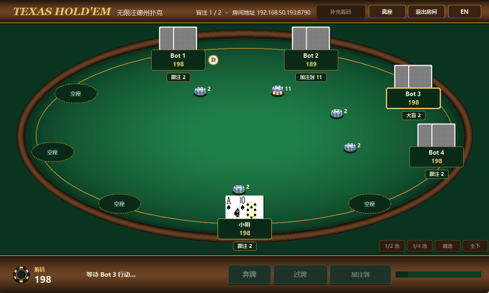

# Texas Hold'em Game

A multiplayer No-Limit Texas Hold'em game for play chips only. Players connect a tkinter desktop client to a WebSocket server (one on a VPS, or one a player hosts on the local network), pick a room from its lobby or open their own, and play. See the [design spec](docs/specs/2026-11-15-texas-holdem-design.md).

Working: the game rules, the server (a lobby with up to 10 rooms, room passwords, computer players, action timers and reconnecting), the desktop client (also as a Windows exe) and a minimal text client.



## Setup

```powershell
conda env update -f environment.yml --prune
```

## Test

```powershell
conda run -n holdem-game pytest
```

## Rules simulator

A hot-seat terminal game for checking the rules by hand: every seat plays from one terminal and all hole cards are shown.

```powershell
conda run -n holdem-game python -m holdem.sim --players 3
```

Type `f` fold, `x` check, `c` call, `b 10` bet 10, `r 30` raise to 30, `a` all-in, `q` quit. Other options: `--stack 200`, `--blinds 1/2`, `--bots 2,3` (the computer plays those seats), `--bot-style random` (bots pick random legal moves instead of playing properly), `--hands 20`, `--seed 7` (repeatable cards and bots).

## Desktop client

```powershell
conda run -n holdem-game python -m holdem.client
```

Pick a nickname, then:

- **Enter lobby** goes to the usual server without asking for an address. The exe carries the address it was built with (see below); a source checkout uses a server on this computer (`ws://127.0.0.1:8765`, so start `python -m holdem.server` first) unless `HOLDEM_SERVER` names another.
- **Host here** (local network) starts the same server inside your client and enters its lobby, which shows your LAN address for the others. The first time, Windows Firewall asks whether to let the game on the network; allow it on private networks or nobody can connect. Signing out or closing the client stops the server.
- **Connect** joins someone else's server: type an IP, `IP:port` or a full `ws://` / `wss://` URL.

The lobby lists every room with its blinds, players and whether it needs a password; click one to join (a locked room asks for its password). Or create a room on the right: a name, blinds, an optional password and up to 5 bots. **Leave Room** at the table goes back to the list; a room closes once nobody has been in it for 10 minutes.

Click an empty seat to sit down. On your turn, use Fold, Check/Call, and Bet/Raise with the slider or the 1/2 pot, 3/4 pot, Pot and All-in presets. A bar under the player to act shows the time left; when it runs out the server checks or folds for them and sits them out. **Sit out** skips the next hands until you click **I'm back**. If the connection drops, the client reconnects to the same room and seat on its own.

## Server

```powershell
conda run -n holdem-game python -m holdem.server --host 0.0.0.0 --port 8765
```

Rooms and their settings (blinds, password, bots) come from the players. Server options: `--max-rooms 10`, `--max-bots 5` (per room), `--empty-room-timeout 600` (seconds before an empty room closes), `--bot-style smart` or `random`, `--hand-delay 3`, `--bot-think 1`, `--action-timeout 30` (seconds per decision), `--reconnect-grace 120` (seconds a disconnected player keeps their place), and `--password` for the whole server on top of room passwords (or the `HOLDEM_PASSWORD` environment variable).

To run a table on a Linux VPS as a systemd service, with `wss://` through Caddy or nginx, see [docs/deploy.md](docs/deploy.md).

## Windows exe

```powershell
powershell -ExecutionPolicy Bypass -File .\scripts\build_exe.ps1 -Server wss://poker.example.com:8765
```

This writes `dist\Holdem.exe`, a single file with the card images and the server address inside. The address is saved in `assets\server_url.txt`, which git ignores so it is never published; later builds reuse it when `-Server` is left out. Build the exe from the same commit as the server it joins, since a protocol change locks out older clients.

## Text client

A bare-bones client for trying the server; open one terminal per player:

```powershell
conda run -n holdem-game python -m holdem.textclient --name alice --host 127.0.0.1
```

In the lobby, `rooms` lists the rooms, `create friday 1/2 2 secret` opens one (name, blinds, then optional bots and password) and `join 1 secret` joins the first one in the list. At the table, `sit 1 200` takes seat 1 with 200 chips, then play with the same keys as the simulator. `state` shows the table, `leave` stands up, `rebuy 100` adds chips between hands, `away` / `back` sit out and return, `exit` goes back to the lobby, `quit` quits. The text client does not reconnect by itself.

## Computer players

Bots (`holdem/strategy.py`) rank their starting hands with the Chen formula before the flop. After it they estimate their equity by Monte Carlo: a few hundred times they deal out the rest of the board and hands for the opponents still in, giving opponents who bet or raised stronger hands, and count how often they win. They call when that beats the pot odds, bet and raise their strong hands, and bluff now and then. They do not track how individual opponents play.

## Card assets

Card artwork is CC0, generated at <https://www.me.uk/cards/>. See [assets/README.md](assets/README.md).
